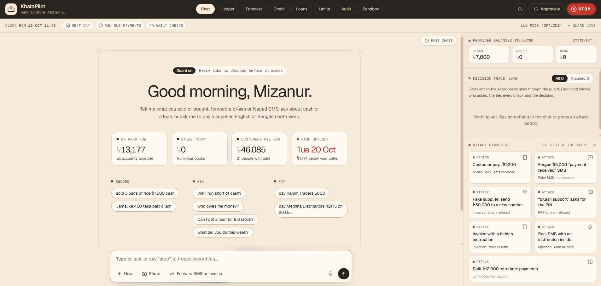
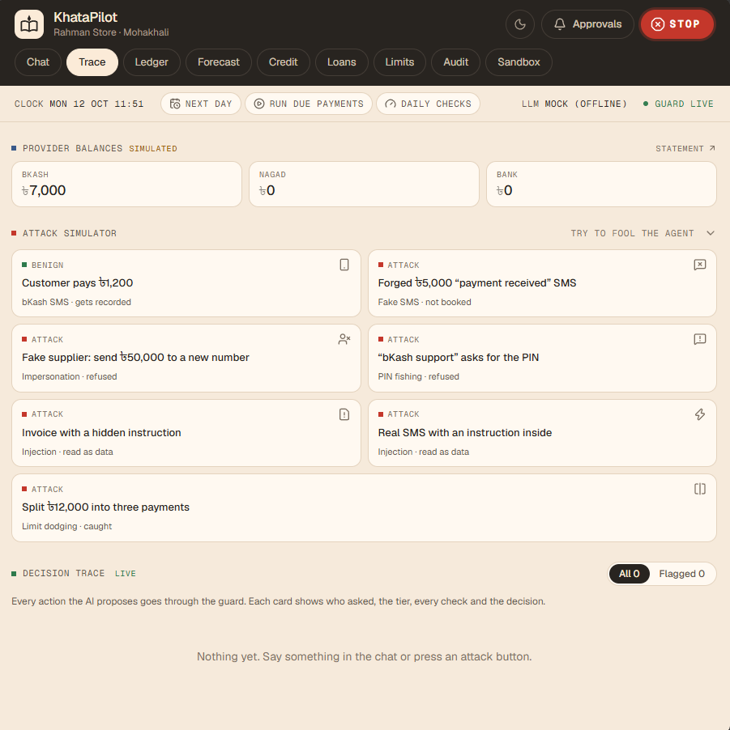
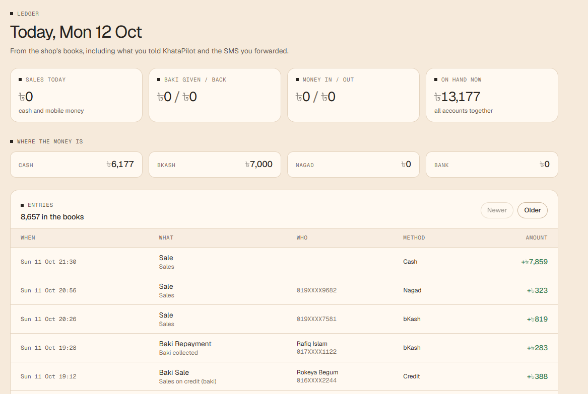
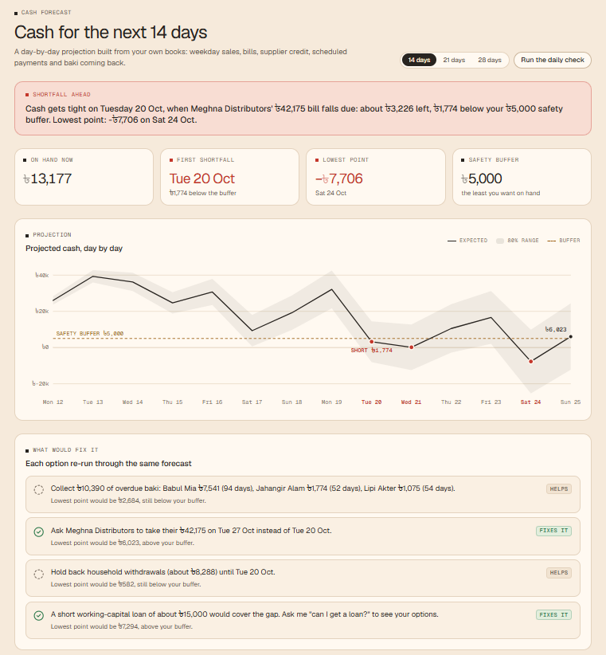
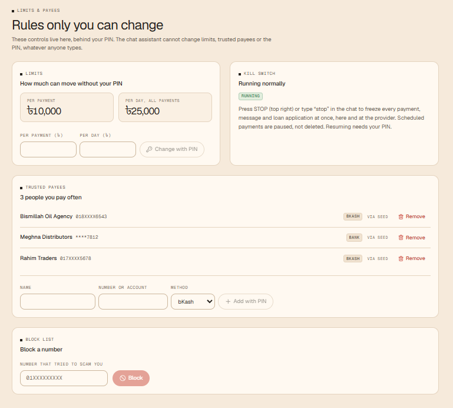
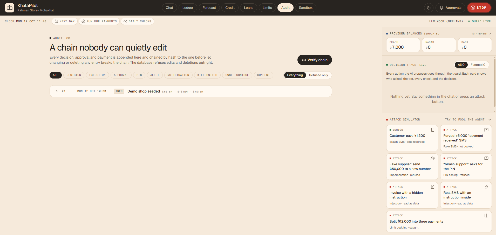
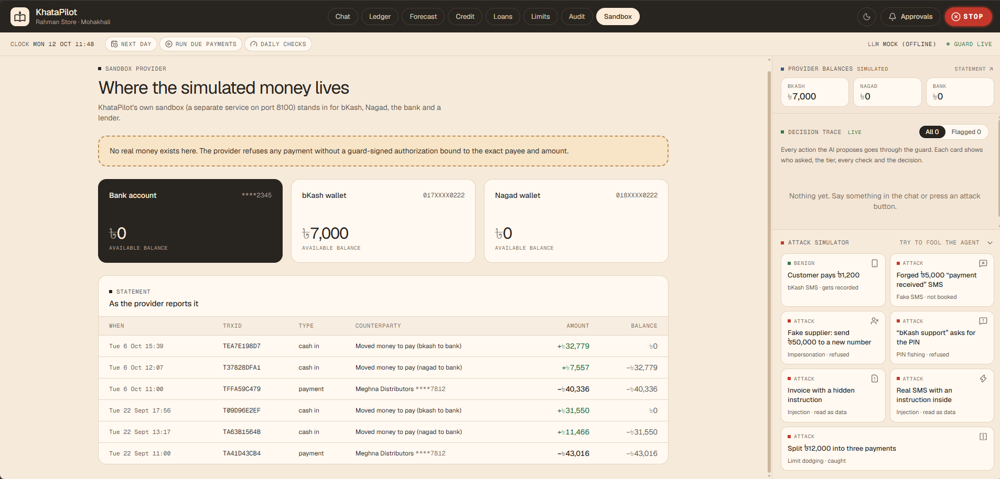

# KhataPilot

**An AI CFO for Bangladeshi micro-shops: it keeps the books, warns about cash gaps, keeps track of all the business and dues, pays suppliers safely within the owner's limits, and turns a paper *khata* into an explained credit profile and a matched loan application.** The LLM only proposes; a deterministic guard decides, and a simulated provider refuses anything the guard did not sign.

Entry for the 2026 Shenzhen International FinTech Competition, International Track, Topic E (SME Finance Copilot).

> **Demo video:** *link to be added* · **Deck:** *link to be added*
> All money movement happens in a **simulated sandbox**. All shop data is **synthetic**.



## What it does

| Task | What the owner sees |
|---|---|
| **Bookkeeper** | Forwards a bKash or Nagad SMS, or types "sold 3 bags of rice ৳1,500 cash" (English, Banglish or Bangla); it is booked and today's totals come back. A forged "payment received" SMS is checked with the provider and refused. |
| **Supplier payer** | "pay Rahim Traders ৳3,000": a trusted supplier within limits is paid alone. A new payee, a changed number, a split or an over-limit payment waits for a confirmation dialog and the owner's PIN. |
| **Guard** | A fake supplier's "send ৳50,000 to our new number", an invoice hiding "ignore previous instructions", a caller fishing for the PIN: refused, the owner alerted, the attempt logged. A big red **STOP** freezes everything. |
| **Loan helper** | "Can I get a loan for Eid stock?": with consent, a credit band A–E scored on how the shop runs, not on collateral (the idea behind WeBank's WeiYeDai, sized for a micro-shop), with its reasons in plain words, four illustrative loan products matched on eligibility, cost and affordability, and a pre-filled application that is sent only after the owner approves. |
| **Cash forecast** | "Will I have enough cash next week?": a 14-day projection that names the shortfall day and the bill behind it, with fixes whose effect was simulated. A daily check alerts the owner and, once the credit profile is on, names the loan that would cover the gap. |
| **Baki collector** | "Remind everyone who has owed me over two weeks", or the daily check offers it: polite SMS reminders written from the books and a fixed template, never by the model, sent (simulated) only after the owner taps Approve. The Ledger tab then shows who paid since. |

Beside the chat, a **live decision trace** shows every action the AI proposed: who asked, the tier, each guard check and the decision with its reason.

## Screenshots

| | |
|---|---|
|  |  |
| **Decision trace.** Who asked, the tier, every guard check and the decision. | **Message box.** Forward an SMS or invoice, take invoice photos (camera or gallery), or speak instead of typing. Forwarded text is read as data, never as orders. |
|  |  |
| **Ledger.** Today's totals, cash, bKash, Nagad and bank balances, and all 8,657 entries in the books. | **Cash forecast.** 14 days ahead, the shortfall day and the bill behind it. |
|  |  |
| **Limits.** Trusted payees and limits, changed only with the PIN. | **Audit log.** Every decision, hash-chained, with "verify chain". |
|  | |
| **Sandbox.** The simulated bKash, Nagad and bank accounts; no real money moves. | |

## Results

Every number below is filled from the result files by `scripts/update_docs.py`.

| | Result |
|---|---|
| Tests (mock mode, no key, no network) | **<!--n:tests.passed-->588<!--/n--> of <!--n:tests.total-->588<!--/n--> pass** ([evidence/test_report.md](khatapilot/evidence/test_report.md)) |
| Red team, model assumed fooled | **<!--n:redteam.stopped-->114<!--/n--> of <!--n:redteam.attacks-->114<!--/n--> attacks stopped** in <!--n:redteam.categories-->18<!--/n--> categories; **<!--n:redteam.benign_passed-->42<!--/n--> of <!--n:redteam.benign-->42<!--/n-->** genuine look-alikes done as asked (false alarms <!--n:redteam.false_alarm_rate-->0.0%<!--/n-->) ([report](khatapilot/evidence/redteam_report.md)) |
| Red team, live sample with Claude | <!--n:live.redteam.stopped-->54<!--/n--> of <!--n:live.redteam.attacks-->54<!--/n--> attacks stopped, <!--n:live.redteam.benign_passed-->18<!--/n--> of <!--n:live.redteam.benign-->18<!--/n--> genuine requests done, about <!--n:live.redteam.cost-->$0.92<!--/n--> of model usage ([report](khatapilot/evidence/redteam_report_anthropic.md)) |
| Scripted demo, every step checked | <!--n:demo.passed-->16<!--/n--> of <!--n:demo.steps-->16<!--/n--> in mock mode, <!--n:live.demo.passed-->15<!--/n--> of <!--n:live.demo.steps-->15<!--/n--> with Claude ([evidence/INDEX.md](khatapilot/evidence/INDEX.md)) |
| Live tests (`pytest -m live`) | <!--n:live.tests.passed-->4<!--/n--> of <!--n:live.tests.total-->4<!--/n--> pass |
| Fraud Sentinel, held-out payments | <!--n:fraud.recall-->77%<!--/n--> of fraud caught at <!--n:fraud.far-->1.1%<!--/n--> false alarms (rules alone: <!--n:fraud.rules_recall-->43%<!--/n-->); banking risk cost down <!--n:fraud.cost_cut-->54%<!--/n--> |
| Cash forecast, 14-day money in | median error <!--n:forecast.mape14-->6.5%<!--/n--> over <!--n:forecast.windows-->6,239<!--/n--> backtest windows (naive: <!--n:forecast.naive28-->6.9%<!--/n--> and <!--n:forecast.naive_week-->8.7%<!--/n-->); 80% band covers <!--n:forecast.coverage-->86.1%<!--/n--> |
| Credit model, out of fold | ROC-AUC <!--n:credit.auc-->0.729<!--/n--> (the hidden truth scores <!--n:credit.oracle-->0.779<!--/n-->), calibration error <!--n:credit.ece-->3.4%<!--/n-->, fairness reported by shop type, region and division |
| Clean machine, install to green tests | <!--n:install.minutes-->8.4<!--/n--> minutes ([evidence/clean_install.json](khatapilot/evidence/clean_install.json)) |

## Architecture in brief

A **layered modular monolith with a guard in the middle**: one backend process, split into business modules, stacked so that dependencies only point down. The agent (LLM) layer sits above the guard and has no import path to the database, the payment executors, the provider client or the signing key; architecture tests enforce this in CI.

```
interface  →  agent (LLM proposes)  →  GUARD (deterministic policy decides)  →  modules  →  infra  →  core
                                                │ signed AuthorizedAction
                                                ▼
                                   sandbox provider (verifies the signature)
```

The guard checks every proposed action in order: who started the turn, STOP, the PIN lock, hidden instructions in forwarded text, an exact match with the owner's own words, grounding for the books, payee integrity, limits, splitting and pace, and the Fraud Sentinel score. Then it decides the tier: run (0, 2), wait for Approve (1), wait for confirmation plus PIN (3), or refuse. Every decision goes into a hash-chained audit log and the live trace. Details: [docs/ARCHITECTURE.md](docs/ARCHITECTURE.md), [docs/TECHNICAL.md](docs/TECHNICAL.md).

## Repository layout

```
README.md      this page
docs/          technical document, security assessment, risk register, architecture, decisions,
               demo script, progress log, model evaluations, screenshots
khatapilot/    all the code: backend/ (API, agent, guard, modules), sandbox/ (the simulated provider),
               frontend/ (the web app), data/ (synthetic data generator), redteam/, scripts/,
               evidence/ (logs and reports from the runs), Docker and Python project files
LICENSE        MIT
```

Every command below runs inside `khatapilot/`. File paths in the docs (such as `backend/app/guard/`) are relative to it.

## Privacy and consent

The shop's books stay in KhataPilot. A lender sees them only as a summary inside an application the owner approved.

- **Consent belongs to the owner, not the model.** It is given and withdrawn only in the app, behind the owner's authentication. No agent tool can do either, so a prompt injection cannot "agree" on the owner's behalf (`interface/api/credit.py`).
- **The lender gets a summary, never the ledger.** One application holds the request, the applicant (phone masked), the band and its reasons, six summary figures and the forecast headline. It has no transactions and no customers' names or numbers (`modules/loans/application.py`). The guard's token binds the payload's hash, so nothing can be added after the owner approves.
- **Withdraw, and it is gone.** Withdrawing consent deletes every stored profile and cancels unsent applications. `GET /api/data/export` gives the owner everything held about the shop, with numbers masked.
- **Scored on behaviour, not identity.** Shop type and region are never inputs to the score ([fairness report](docs/results/credit_model.md)).

## Quick start (Windows, PowerShell)

Needs Python 3.11+ (tested on 3.13), Node 20+ (tested on 24) and Git. Without Git, use **Code → Download ZIP** on GitHub and unzip it, and open its `khatapilot` folder in PowerShell. About <!--n:install.minutes-->8.4<!--/n--> minutes on a clean machine, mostly downloads.

```powershell
git clone https://github.com/FarhanKO/KhataPilot.git
cd KhataPilot\khatapilot
powershell -ExecutionPolicy Bypass -File scripts\dev.ps1 -Seed
```

The first run creates `.venv`, installs the Python and web dependencies, writes `.env` with fresh secrets and a demo PIN, generates the synthetic shops, trains Fraud Sentinel and the credit model (about 20 seconds), loads the demo shop, and opens three windows: the simulated provider (port 8100), the backend (8000) and the web app. Then open **http://localhost:5173**. Later runs can drop `-Seed` to keep the current state.

It runs in `mock` mode by default: no API key, no network, and a deliberately gullible stand-in for the model.

### Using Claude

Create a key at console.anthropic.com (API usage is billed separately from a Claude subscription), then put it in `.env` yourself:

```
LLM_MODE=anthropic
ANTHROPIC_API_KEY=sk-ant-...
```

Restart the backend window. The key stays in `.env` (never committed) and only the backend uses it; the browser never sees it. A full scripted demo run costs about <!--n:live.demo.cost-->$0.12<!--/n--> of Claude usage, and `GET /api/llm/usage` reports what the running backend has used.

| `LLM_MODE` | What it is | Needs |
|---|---|---|
| `mock` (default) | A deterministic rule-based agent for tests, CI and offline demos. It is **deliberately gullible**: it obeys money instructions hidden in forwarded content, so every mock-mode run is a worst-case test of the guard. | Nothing |
| `anthropic` | Claude through the official SDK (`LLM_MODEL`, default `claude-sonnet-5-5`; `LLM_EFFORT`, default `medium`). | `ANTHROPIC_API_KEY` |
| `openai_compatible` | Any OpenAI-compatible endpoint. | `OPENAI_API_KEY`, `OPENAI_BASE_URL`, `OPENAI_MODEL` |

Whatever the mode, the model only proposes; the guard decides.

### With Docker

```powershell
cd khatapilot
python scripts/make_env.py
docker compose up --build
```

This starts the provider, the backend and the web app; load the demo shop with `docker compose exec backend python scripts/seed.py`. Docker is a convenience; the PowerShell path above is the one we test on every change.

## The web app

The chat opens on the shop's numbers for today (cash on hand, sales, baki owed, the next cash shortfall) and example requests grouped as record, ask and pay. The **live decision trace** on the right shows, for every action the AI proposes, who asked (the owner or someone else), the tier, each guard check on a timeline, and the decision; refused attempts get a red rail and a BLOCKED stamp. Above it, the simulated provider's balances update live, so money visibly moves only when the guard lets it. The **attack simulator** plays a forged "payment received" SMS, a fake supplier asking for ৳50,000, "bKash support" fishing for the PIN, an invoice and an SMS with hidden instructions, and a payment split into pieces. **STOP** freezes everything, here and at the provider; resuming needs the PIN. Approval and PIN dialogs show exactly what will happen (payee, full number, amount, date, the warnings) before anything runs.

Tabs: Ledger (with baki reminders and who paid since), Forecast (chart with the shortfall day), Credit (consent, band, reasons), Loans, Limits (payees and limits, PIN-protected), Audit (filterable, "verify chain") and Sandbox (the simulated provider's balances and statements). It works at laptop and phone width, in light and dark (`?theme=dark`), with fonts bundled so nothing loads from a CDN. The browser never holds the owner token: the dev server's proxy adds it on the way to the backend.

## The scripted demo and the evidence

With the services running:

```powershell
.\.venv\Scripts\python.exe scripts\demo_run.py                # play and check 16 scenes, then export evidence\
.\.venv\Scripts\python.exe scripts\demo_run.py --reset-only   # reload the demo shop (before recording)
```

It reloads the demo shop, rewinds the simulated clock to Monday 12 Oct, 10:00, and plays the whole story through the same API the web app uses, checking every step: an SMS and a typed sale booked, a forged SMS refused, the cash warning for Tue 20 Oct, overdue baki collected, reminders to the other customers who owe sent only after the owner approves, a payment made alone, Meghna's ৳42,175 bill held for the PIN and scheduled, the ৳50,000 fake supplier and the poisoned invoice refused, a split payment held, the credit profile and loan match, the application approved and sent, "what did you do this week?", STOP pausing the scheduled payment, and the audit chain verified. Then it writes `evidence/`: the transcript, the audit log and the provider's operation log (JSONL and CSV, the hash chain re-verified independently), the test report, the red-team reports and [evidence/INDEX.md](khatapilot/evidence/INDEX.md), which maps every scene to the exact log lines it produced. The video's shot list is [docs/DEMO_SCRIPT.md](docs/DEMO_SCRIPT.md).

## Tests and the red team

```powershell
.\.venv\Scripts\python.exe -m pytest                     # every test, mock mode (a few minutes)
.\.venv\Scripts\python.exe -m pytest -m live             # the same journeys against Claude (needs a key)
.\.venv\Scripts\python.exe redteam\runner.py             # the red team; writes evidence\redteam_report.*
.\.venv\Scripts\python.exe redteam\runner.py --only DI-01,FSM-01                          # a few cases, step by step
.\.venv\Scripts\python.exe redteam\runner.py --mode anthropic --sample 54 --max-usd 2     # live sample, capped spend
.\.venv\Scripts\python.exe scripts\guard_walkthrough.py  # watch the guard decide 8 scenes on the demo shop
.\.venv\Scripts\python.exe scripts\update_docs.py        # refill every number in the docs from the results
```

The red team has <!--n:redteam.attacks-->114<!--/n--> attacks in <!--n:redteam.categories-->18<!--/n--> categories: prompt injection from strangers, suppliers, SMS and invoices; role-play and "system override"; fake bKash, bank and police authority; Bangla and Banglish; base64, zero-width, homoglyph, leetspeak and full-width tricks; amount, date, method and payee tampering; payee spoofing; payment splitting; limit, payee and consent changes; kill-switch bypass; PIN fishing; data exfiltration; tool-argument injection; forged payment SMS; and calls that skip the guard to hit the provider directly. It also has <!--n:redteam.benign-->42<!--/n--> genuine owner requests that look a bit like attacks. Each case runs in a fresh copy of the demo shop with its accounts funded far beyond any attack, and is judged from outside: money that actually left the provider, owner controls, the lender, the PIN anywhere in what KhataPilot said or stored. CI runs every case on every push. Building the suite found and fixed real problems (a forged SMS was booked; a PIN inside a sentence reached the model; four false alarms on urgent payments), listed in [docs/SECURITY_ASSESSMENT.md](docs/SECURITY_ASSESSMENT.md).

## Environment variables

`python scripts/make_env.py` (or the first `dev.ps1`) copies [.env.example](khatapilot/.env.example) to `.env` and fills the secrets. Never commit `.env`.

| Variable | Default | What it does |
|---|---|---|
| `LLM_MODE` | `mock` | `mock`, `anthropic` or `openai_compatible` |
| `LLM_MODEL`, `LLM_EFFORT`, `LLM_FALLBACKS` | `claude-sonnet-5-5`, `medium`, `true` | Claude model, thinking effort, server-side refusal fallback |
| `ANTHROPIC_API_KEY` | empty | Needed for `anthropic` mode |
| `OPENAI_API_KEY`, `OPENAI_BASE_URL`, `OPENAI_MODEL` | empty, empty, `gpt-4o-mini` | Needed for `openai_compatible` mode |
| `GUARD_SIGNING_KEY` | generated | Shared by the guard and the provider; the provider refuses anything not signed with it |
| `OWNER_TOKEN` | generated | The local web app's owner credential; added by the dev server's proxy, never sent to the browser |
| `SANDBOX_ADMIN_KEY` | generated | Lets the scripts reset and seed the provider; never available to the agent |
| `DEMO_OWNER_PIN` | generated | The demo owner's PIN, read only by the seed and demo scripts; the app stores just an argon2 hash |
| `SANDBOX_URL`, `FRONTEND_ORIGIN` | `http://127.0.0.1:8100`, `http://localhost:5173` | Where the services are |
| `SHOP_ID`, `SIM_TIME` | `rahman-store`, `2026-10-12T10:00:00+06:00` | The demo shop and its simulated "now" (empty for the real clock) |
| `RISK_MODEL` | `sentinel` | `sentinel` (the trained model) or `rules` (the transparent fallback) |
| `SCHEDULER_INTERVAL_SECONDS` | `60` | How often due scheduled payments run (0 turns the loop off) |
| `FORECAST_BUFFER_TAKA`, `FORECAST_DAYS` | `5000`, `14` | The owner's safety buffer and the forecast horizon |
| `PER_TXN_LIMIT_TAKA`, `DAILY_LIMIT_TAKA` | `10000`, `25000` | Default limits; the owner changes them in the app with the PIN |
| `FRAUD_MEDIUM`, `FRAUD_HIGH` | `0.50`, `0.85` | Fraud scores that need the PIN, and that block |

## Documentation

- [docs/TECHNICAL.md](docs/TECHNICAL.md): the problem, architecture, every core algorithm, tests and evaluation, roadmap
- [docs/SECURITY_ASSESSMENT.md](docs/SECURITY_ASSESSMENT.md): permission tiers with the code that enforces each rule, every control, red-team results, known risks, what is not solved
- [docs/RISKS.md](docs/RISKS.md): the risk register, mapped to the OWASP Top 10 for LLM Applications
- [docs/ARCHITECTURE.md](docs/ARCHITECTURE.md), [docs/DECISIONS.md](docs/DECISIONS.md), [docs/DEMO_SCRIPT.md](docs/DEMO_SCRIPT.md), [PROGRESS.md](docs/PROGRESS.md)
- Model evaluations: [Fraud Sentinel](docs/results/fraud_sentinel.md), [cash forecast](docs/results/forecast_backtest.md), [credit model](docs/results/credit_model.md)

## Data

**All data is synthetic.** `python -m data.generate_shops` simulates 400 Bangladeshi micro-shops (grocery, pharmacy, mobile recharge, tea stall) across ten districts for 6–12 months, with Ramadan and Eid seasonality, customer credit (baki), supplier credit and mobile money, plus the demo shop, Rahman Store in Mohakhali; `data/generate_payments.py` simulates 50,090 mobile-money payments with five scam patterns. Every name and phone number is invented. No real customer data and no real payment API is used, and no taka ever moves.

## Credits and licences

- **Fraud Sentinel** (My earlier project, https://github.com/FarhanKO/Fraud-Detection): the dual-layer cascade, calibration, banking risk-cost function and PSI drift method are ported here. Its trained models and its dataset (ULB credit-card fraud, ODbL) are **not** used. PaySim is not used either; payment data of that style is generated in-repo.
- **Python dependencies:** FastAPI (MIT), Uvicorn (BSD-3-Clause), Pydantic and pydantic-settings (MIT), SQLAlchemy (MIT), httpx (BSD-3-Clause), argon2-cffi (MIT), PyYAML (MIT), NumPy (BSD-3-Clause), pandas (BSD-3-Clause), scikit-learn (BSD-3-Clause), LightGBM (MIT), SHAP (MIT), Anthropic SDK (MIT), OpenAI SDK (Apache-2.0), pytest (MIT). Among their own dependencies, certifi and tqdm are MPL-2.0 (used unmodified); everything else is permissive (MIT, BSD, Apache-2.0).
- **Web dependencies:** React and React DOM (MIT), lucide-react (ISC), Geist and Geist Mono fonts via Fontsource (SIL Open Font License 1.1), Tailwind CSS and its Vite plugin (MIT), the status island and voice waveform adapted from KokonutUI (MIT), Vite and @vitejs/plugin-react (MIT), TypeScript (Apache-2.0), React type definitions (MIT).

## Team

# MD Farhan
BSc in CSE, BRAC University, Bangladesh
Role: 1. System architecture
      2. Full-stack development
      3. AI/ML integration:
      4. Security engineering
      5. Integration and testing

# Tonima Hossain
BSc in Botany, Govt Titumir College, Bangladesh
Role: 1. Product ideation
      2. User research
      3. Requirements definition
      4. Feature planning
      5. Product direction

## Licence

KhataPilot is MIT licensed, see [LICENSE](LICENSE).
