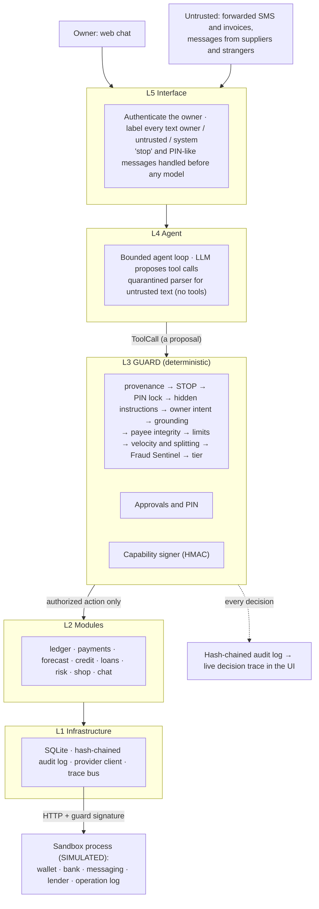

# KhataPilot: technical document

**An AI CFO for Bangladeshi micro-shops that keeps the books, warns about cash gaps, pays suppliers safely within the owner's limits, refuses fraud and prompt injection, and turns a shop's history into an explained credit profile and a matched, pre-filled loan application.**

Entry for the 2026 Shenzhen International FinTech Competition, International Track, Topic E (SME Finance Copilot). All data is synthetic and all money movement goes through a simulated provider. Every number in this document is filled from the evaluation outputs by `scripts/update_docs.py`; none is typed by hand.

## 1. The problem

Bangladesh has millions of micro-shops: groceries, pharmacies, mobile-recharge counters and tea stalls. Most keep their accounts in a paper *khata*, sell partly on informal customer credit (*baki*), buy stock on supplier credit, and take more and more of their payments through mobile money (bKash, Nagad). Banks cannot score them, because there are no statements and no audited accounts, so the owner borrows from relatives or informal lenders when cash runs short before a supplier's bill or before Eid.

The same owner is the target of a steady stream of scams: forged "you have received Tk 5,000" SMS, callers posing as bKash support asking for a PIN, and "suppliers" who announce a new payment number. An AI assistant that can pay suppliers makes these scams worse unless it is built so that a fooled model still cannot move money.

Topic E asks for three capabilities: **financing-option matching, cash-flow management with alerts, and business financial analysis**. KhataPilot covers all three with five core tasks, all of them working end to end in the web chat with the real model and with a deterministic stand-in:

| Task | Tier | What the owner sees | Where it is proved |
|---|---|---|---|
| Bookkeeper | 0 | Forwards a bKash SMS or types "sold 3 bags of rice ৳1,500 cash"; it is booked and today's totals come back | Demo scenes 1, 2, 5; `test_bookkeeping_tools.py`, `test_sms_parser.py` |
| Supplier payer | 2 / 3 | "pay Rahim Traders ৳3,000": paid alone within limits; ৳42,175 to Meghna waits for the PIN | Scenes 7, 8, 11; `test_payments.py`, `test_policy_engine.py` |
| Guard | Blocked | A fake supplier's ৳50,000 demand, an invoice with hidden orders and a forged SMS are refused and the owner is alerted | Scenes 3, 9, 10; the red-team suite |
| Loan helper | 0 / 1 | "Can I get a loan for Eid stock?" gives band B with reasons in plain words, a ৳30,000 microfinance loan the shop can afford, and an application the owner approves | Scenes 12, 13; `test_credit.py`, `test_loans.py` |
| Cash-flow forecast | 0 | "Will I have enough cash next week?" names Tuesday 20 Oct, the bill behind it, and fixes whose effect was simulated | Scene 4; `test_forecast.py` |

## 2. Architecture

KhataPilot is a **layered modular monolith with a guard in the middle**: one backend process, split into business modules, stacked so that dependencies only point down. The middle layer is the guard, a deterministic policy engine that is the only path from "the agent wants to do X" to "X happens".

**The rule everything serves: the LLM never has authority.** It can propose an action; a deterministic guard decides using facts the LLM cannot change: who sent the message, the owner's own words, the stored limits and trusted payees, the fraud score and the owner's PIN. Three properties make this structural rather than a convention:

1. **No import path.** The agent layer cannot import the database, the payment executors, the provider client or the signing key; its only door is `app.guard.api`. Fifteen architecture tests parse every source file and fail the build otherwise (`backend/tests/architecture/test_layers.py`).
2. **Signed side effects.** Every payment, message or loan application carries a guard-minted HMAC token bound to the exact payee, amount and idempotency key. The provider, a separate process, verifies it and refuses everything else, including direct calls that skip KhataPilot.
3. **Facts outside the model.** Who is speaking comes from the channel adapter; what the owner asked for is re-extracted from the owner's own text by code; limits, payees and the PIN live in the guard's store. None of them is read from the model's tool arguments.

**Why a monolith.** It had to be built in eight days and demoed on one laptop: one deployable, one database file, no network between modules. The boundary around the guard is already a service boundary, so the guard can move into its own process, with its key in an HSM, without changing the agent or the modules.

**Processes.** The backend (FastAPI, port 8000), the sandbox provider (FastAPI, port 8100, its own database and operation log; every response marked `"simulated": true`) and the web app (React, Vite, TypeScript, Tailwind, port 5173). `scripts\dev.ps1` starts all three on Windows; `docker compose up` does the same.

## 3. Core algorithms

### 3.1 Bookkeeping

**SMS parsing.** A pure-regex parser (`core/sms.py`) reads bKash, Nagad and bank notifications: money received, payments received, cash in, payments sent, send money, cash out, bank debits and credits, with the amount, fee, balance, counterparty number, TrxID and time. It accepts `৳`, `Tk`, `BDT`, thousands separators and Bangla digits (০–৯), and every result is validated by Pydantic. No model is involved: a forwarded SMS is untrusted text, and parsing it must not depend on something that can be talked into anything.

**Typed entries.** The owner writes in English, Banglish or Bangla ("3 bosta chal 1500 taka cash e bikri"). The model turns this into a structured ledger entry, but the guard's *grounding* check books it only if the amount literally appears in the owner's message (`guard/checks.py::grounded`). The model cannot invent or alter a figure.

**Booking by reference, confirmed by the provider.** For a forwarded SMS the model calls `record_sms(segment=n)` and the guard re-parses the original text, so the model never retypes an amount. The entry is booked only after the provider confirms the same TrxID, direction and amount on the shop's own account (`modules/payments/service.py::check_sms`). A forged "payment received" SMS, the commonest scam against shopkeepers, therefore changes nothing. A customer's payment is matched to their baki; a payment to a supplier settles their bill; duplicates are refused.

### 3.2 The agent

The agent loop (`agent/orchestrator.py`) is manual and bounded at 6 model calls per message. Each turn is rendered with the owner's words and any untrusted blocks fenced as data, the model proposes tool calls, each call goes to the guard as its own database transaction (decided, executed, audited and committed before the model hears back), and the results return to the model as data. Fourteen tools cover the five tasks: `add_ledger_entry`, `record_sms`, `get_today_summary`, `get_balances`, `list_debtors`, `list_recent_entries`, `list_trusted_payees`, `forecast_cash`, `summarize_activity`, `propose_payment`, `build_credit_profile`, `match_loans`, `prefill_application` and `notify_owner`. Owner-only controls (limits, payees, the PIN, resuming after STOP, credit consent) are deliberately not tools.

**Three provider modes** sit behind one interface (`agent/llm/`):

- `anthropic` (used for the video): Claude Sonnet 5.5 through the official SDK, with adaptive thinking at effort `medium` (the recommended starting point for multistep tool use), `tool_choice` auto, top-level prompt caching, the server-side refusal fallback, and refusals checked before content. Conversation history is append-only and earlier turns are sent as text, so nothing under a thinking block is ever edited and the cached prefix stays stable. When the owner approves or cancels something in the app, the app adds a short note to that conversation, so the model's history matches what happened.
- `openai_compatible`: any OpenAI-compatible endpoint.
- `mock`: a deterministic rule-based planner that is **deliberately gullible**. It proposes any money instruction it finds in forwarded content or a stranger's message, so every mock-mode test and red-team run is a worst-case test of the guard. CI runs everything in this mode with no key and no network.

The model's reply language follows the owner's latest message (English, Banglish or Bangla script); money is written as `৳12,500`.

### 3.3 The guard

`ToolGateway.submit` (`guard/gateway.py`) validates the arguments against a strict schema, turns the call into a `ProposedAction`, fills in a trusted payee's saved number and method (so the model never chooses where money goes), and runs the policy engine. The engine evaluates every check, even after one blocks, so the decision trace always shows the full picture:

| # | Check | Facts used | On failure |
|---|---|---|---|
| 1 | Provenance | Who started the turn (set by the channel adapter) | Block |
| 2 | Kill switch | The global freeze | Block every tier 1–3 action |
| 3 | PIN lock | Failed-attempt counter | Block for 15 minutes after 3 wrong PINs |
| 4 | Hidden instructions | Injection scan of forwarded text; numbers that appear only in it | Payee number from forwarded text: block. Orders in forwarded text: PIN |
| 5 | Owner intent | Payee, amount and date re-extracted from the owner's own words | No exact match: block |
| 6 | Grounding | Ledger amounts must appear in the owner's words or a confirmed SMS | Block |
| 7 | Payee integrity | Trusted payees (name and number), blocklist | New payee or known name at a new number: PIN with a warning; blocklisted: block |
| 8 | Limits | ৳10,000 per payment, ৳25,000 a day (owner-set, PIN-protected) | PIN |
| 9 | Velocity and splitting | Same-payee and new-payee totals over 24 h; payments per hour | PIN |
| 10 | Fraud Sentinel | Score against 0.50 and 0.85 | Medium: PIN. High: block |

The tier is the action's base tier raised by every escalation; any block wins (`guard/tiers.py::decide`). Tier 0 runs, tier 1 waits for Approve, tier 2 runs alone and notifies the owner, tier 3 waits for confirmation plus PIN, and a block refuses, alerts the owner and logs the attempt.

**Intent matching** is exact: payee, amount to the paisa and date must match an unused intent extracted from the owner's own text in this conversation, and each intent authorizes one payment. This is what makes amount tampering, extra payments and "pay on Friday" executed now impossible, even for a model that has been fully compromised.

**Capability tokens.** When an action is allowed, now or after approval, `guard/capability.py` mints an `AuthorizedAction`: the kind, a SHA-256 of the canonical JSON of exactly the fields that move money or data, the idempotency key, tier, decision id, nonce and a 5-minute expiry, signed with HMAC-SHA256. Three places check it: the module executor re-hashes what it is about to send (catching "approved ৳8,000, sent ৳80,000"), the provider verifies signature, expiry and hash against the body it received, and the provider stores the idempotency key so a retry returns the original transaction.

**Scheduled payments** are re-checked on their day (STOP, blocklist, trusted payee, daily cap) and get a fresh token. **STOP** freezes every tier 1–3 action, pauses scheduled payments and freezes the accounts at the provider; resuming needs the PIN. **The audit log** is a separate SQLite file, append-only and hash-chained, recording who asked, provenance, the proposed action, tier, every check, the decision, the plain-English reason and the provider's reference.

### 3.4 Fraud Sentinel, mobile-money edition

The team's earlier Fraud Sentinel project (an anomaly layer and a calibrated gradient-boosted classifier for card fraud) could not score mobile-money payments directly: its models expect the 28 anonymised PCA features of the card dataset. We ported its design and methodology instead and retrained it on features that exist for a bKash payment (`modules/risk/`):

- **Features (12):** log amount; amount relative to the shop's daily sales and to the payee's usual amount; whether the payee has history and how much; whether the payee is trusted; time of day (night flag, cyclic hour); payments in the last hour and day; new payees in the last day.
- **Layer 1:** an Isolation Forest trained on normal payments only; the 99th percentile of its anomaly score escalates and the 99.95th blocks.
- **Layer 2:** LightGBM with isotonic calibration, plus the original's amount-aware threshold (above two days of sales the probability counts double). Per-feature contributions become plain-English reasons on the decision card.
- **Training data:** <!--n:fraud.payments-->50,090<!--/n--> synthetic payments over 1,200 simulated shops, with five scam patterns, including hard ones on purpose (small fee scams, spoofed supplier amounts) and genuine look-alikes (large first payments to new numbers). A first version scored ROC-AUC 0.9996, which nobody should believe; the harder data gives honest numbers and visible blind spots.
- **Safety:** the model file loads only if its SHA-256 matches the sidecar written at training; anything else falls back to a transparent rule-based score, and an exception never fails open.

Evaluated the original's way, on a chronological hold-out (the last 15 days, <!--n:fraud.test-->11,583<!--/n--> payments): ROC-AUC <!--n:fraud.auc-->0.993<!--/n-->. At the guard's medium threshold it catches <!--n:fraud.recall-->77%<!--/n--> of fraud with <!--n:fraud.far-->1.1%<!--/n--> false alarms, against <!--n:fraud.rules_recall-->43%<!--/n--> for the rules baseline, and the banking risk cost (1 per missed taka plus ৳50 per false alarm) falls by <!--n:fraud.cost_cut-->54%<!--/n-->. By pattern: structuring <!--n:fraud.structuring-->95%<!--/n-->, account-takeover bursts <!--n:fraud.takeover-->89%<!--/n-->, spoofed supplier numbers <!--n:fraud.spoof-->49%<!--/n-->, small fee scams <!--n:fraud.scam_small-->0%<!--/n-->. The blind spots are why the payee rules exist: a payment to anyone new needs the PIN whatever its score, and a known name at a new number gets an explicit spoof warning. Feature drift between the training and test windows is negligible (largest PSI <!--n:fraud.max_psi-->0.0041<!--/n-->). Full results: [results/fraud_sentinel.md](results/fraud_sentinel.md).

### 3.5 Cash-flow forecast with alerts

The forecast (`modules/forecast/service.py`) is built from explainable parts, not a black box, because a shop owner and a bank judge must be able to ask "why Tuesday?" and get an answer in taka, and because a shop has about eight weeks of relevant history, too little for a per-shop model:

- **Baselines:** weekday medians of the last 8 weeks for sales, everyday spending and household withdrawals, with Ramadan and Eid effects divided out of history and multiplied back in (`forecast/calendar.py`).
- **Known amounts on known days:** open bills and supplier credit, recurring bills, scheduled payments (netted against the bills they pay), and each regular credit supplier's next bill projected from its own delivery cycle and terms.
- **Baki coming back** as a flow (the last 4 weeks' average collections), not customer by customer; customers' repayment histories are used to name doubtful debts, which are not counted on, and to choose whom to chase.
- **An 80% band** that counts the uncertainty of the baseline level itself as well as day-to-day noise.

The output is a 14-day day-by-day projection with the band, the first day the balance drops below the owner's safety buffer, and its cause. Each suggestion (collect overdue baki, ask a supplier to wait a week, hold back withdrawals, a short loan) is **re-run through the same projection** and reports the new lowest balance and whether it closes the gap. A daily check alerts the owner once; with the owner's consent to a credit profile, the alert also names the sample loan that would cover the gap and the words to ask for it ("apply for the nano-loan to cover the shortfall"). It prepares nothing itself. On the demo shop: *cash gets tight on Tuesday 20 Oct, when Meghna Distributors' ৳42,175 bill falls due, ৳1,774 below the ৳5,000 buffer.*

Backtested (`scripts/evaluate_forecast.py`, using the app's own code) on <!--n:forecast.windows-->6,239<!--/n--> two-week windows across <!--n:forecast.shops-->401<!--/n--> synthetic shops, with only the days before each cutoff: money in over 14 days is off by a median <!--n:forecast.mape14-->6.5%<!--/n-->, against <!--n:forecast.naive28-->6.9%<!--/n--> for "the last 4 weeks' average" and <!--n:forecast.naive_week-->8.7%<!--/n--> for "same as last week". The 80% band held the actual total in <!--n:forecast.coverage-->86.1%<!--/n--> of windows; the bias of <!--n:forecast.bias-->-3.2%<!--/n--> is slightly conservative, the safe side for a shortfall warning. Details: [results/forecast_backtest.md](results/forecast_backtest.md).

### 3.6 Credit profile

Micro-shops have no collateral and rarely a credit-bureau file, so KhataPilot scores how the shop runs. This is the idea behind WeBank's WeiYeDai, unsecured credit for small firms scored on their business data, sized here for a shop whose only records are its khata and its mobile-money SMS. With the owner's consent, given in the app and never through chat, the books become a credit profile (`modules/credit/`):

- **One feature function for training and the app.** The ledger is rebuilt into exactly the per-day table the simulator writes, and the same function computes the features from either; a test proves the demo shop's features are identical both ways. Train/serve skew is the classic way a credit model breaks silently.
- **Features scored (9):** supplier bills paid on time, week-to-week swing in sales, days customer credit stays unpaid, household withdrawals as a share of sales, months of records, sales growth, share of customer credit paid back, days of costs covered by cash, and borrowing from relatives to pay bills. **Shown but not scored (3):** sales level, margin and mobile-money share. An ablation showed they added no accuracy once behaviour was known but widened the gap between urban and rural good payers, because they stand in for shop type and region. Shop type and region are never inputs.
- **Model:** LightGBM with monotone constraints (paying suppliers on time can never raise the risk) and Platt calibration fitted on out-of-fold scores. Bands A–E at 5, 10, 20 and 35% probability of default.
- **Explanations:** TreeSHAP values (checked against the `shap` library to 0.0) become the top reasons in plain words, compared with peers: "You pay supplier bills on time 94% of the time, more often than most shops (77%)."

On <!--n:credit.shops-->400<!--/n--> synthetic shops whose hidden default probability comes from behaviour only, out of fold: ROC-AUC <!--n:credit.auc-->0.729<!--/n--> (<!--n:credit.auc_low-->0.705<!--/n-->–<!--n:credit.auc_high-->0.752<!--/n--> over 8 splits), where even the hidden true probability scores only <!--n:credit.oracle-->0.779<!--/n--> because outcomes are random draws; logistic regression scores <!--n:credit.logistic-->0.690<!--/n-->. Brier <!--n:credit.brier-->0.125<!--/n-->, calibration error <!--n:credit.ece-->3.4%<!--/n-->. An illustrative policy lending to bands A–C approves <!--n:credit.approval_rate-->71%<!--/n--> of shops, of whom <!--n:credit.default_approved-->10.6%<!--/n--> default, against <!--n:credit.default_declined-->33.6%<!--/n--> of those declined.

**Fairness** is checked on out-of-fold predictions, with 95% intervals so that groups of 25–30 shops are not over-read: approval-rate ratio <!--n:credit.type_ratio-->0.84<!--/n--> across shop types and <!--n:credit.urban_ratio-->0.86<!--/n--> between urban, semi-urban and rural shops (both above the four-fifths rule of thumb), but <!--n:credit.division_ratio-->0.72<!--/n--> across divisions, where one small group is not calibrated. The good-payer approval gap is <!--n:credit.type_gap-->15<!--/n--> points by shop type and <!--n:credit.urban_gap-->10<!--/n--> points urban/rural. These are reported, not hidden: [results/credit_model.md](results/credit_model.md).

### 3.7 Loan matching and the application

Four **illustrative** products with invented terms (`modules/loans/products.py`): a mobile-wallet nano-loan (৳1,000–30,000, 1–3 months), a supplier credit extension, a microfinance working-capital loan (৳20,000–300,000, 6 or 12 months) and a bank SME loan (৳100,000 and up). The matcher (`modules/loans/matcher.py`) filters by each product's eligibility rules (credit band, months of records, and where the product asks for them, monthly sales, mobile-money share or supplier punctuality), keeps only products whose instalment is at most 40% of monthly business income, ranks them by total cost, picks the shortest affordable term, and explains why each other product does not fit. With no amount given, it proposes the extra stock for Eid week, a week of stock, or the forecast's gap. For the demo shop: band B and a ৳30,000 microfinance loan at ৳5,356 a month for 6 months, 26% of monthly business income.

`prefill_application` builds the application deterministically from the profile and the books; the guard holds it as a tier-1 action whose stored form is hashed, so what reaches the (simulated) lender is exactly what the owner approved, under a token bound to the account, product, amount, term and payload hash.

### 3.8 Synthetic data

`data/generate_shops.py` simulates 400 micro-shops (grocery, pharmacy, mobile recharge, tea stall) across ten districts for 6–12 months: daily sales with weekday patterns, Ramadan and Eid seasonality, supplier purchases on credit, customer baki and repayment, mobile-money flows, household withdrawals, and liquidity with consequences (when cash is short, supplier payments slip and essential bills force informal borrowing). Each shop has a hidden repayment behaviour, drawn from behaviour only and never from type or region, used as the credit label. The demo shop, Rahman Store in Mohakhali, runs through the same simulator with names attached and a story: a ৳28,000 withdrawal for a family wedding leaves cash tight before two supplier bills. Everything is seeded and reproducible; every name and number is invented.

### 3.9 Baki collector

Customer credit (*baki*) that sits unpaid is the cash a micro-shop most often runs short of, so KhataPilot looks for it every day and offers to chase it, while the owner stays in charge of every message (`modules/reminders/`):

- **Proactive, not autonomous.** Once a simulated day the background loop checks for customers who have owed for 14 days or more and were not reminded in the last week, and alerts the owner with who they are and how much they owe. The check prepares and sends nothing: a turn that is not the owner's can only notify, and that rule is unchanged.
- **Written from the books, not by the model.** The owner asks in chat ("remind them", "tagada dao") or taps *Prepare reminders* in the Ledger tab. The `send_reminders` tool takes only how long a customer must have owed, or names of customers who owe; recipients, numbers and amounts come from the ledger and the words from a fixed English or Banglish template. Names are stripped to name characters. Unknown names, an outside number given as a "customer", or smuggled text and numbers are refused at the tool gateway.
- **Held for Approve (tier 1).** The approval dialog shows every reminder's exact text and masked number. On approval each message gets its own guard token bound to its number and the hash of its text, which the messaging gateway checks. A customer who paid in full while the reminders waited is skipped; STOP freezes reminders like payments; forwarded content that tries to give orders raises them to the PIN; a customer gets at most one reminder a week, 20 at a time.
- **Who paid since.** Each reminder is followed up from the books: paid in full, in part, or not yet ("who paid after the reminders?" in chat, or the Reminders card in the Ledger tab). Demo scene 6 plays the whole loop and checks that nothing is sent before Approve and exactly one SMS per reminder after.

## 4. The interface

The web app puts the chat on the left and the **live decision trace** on the right, streamed over server-sent events, under a strip of the simulated provider's balances that shows each change as it happens (and the lock when STOP freezes the accounts). Each request becomes one card: who asked (the owner, or someone who is not), the tier badge, every guard check on a timeline with ticks and crosses, and the decision with a one-line reason. Approvals, PIN entries and later executions are drawn on the card they settle; refused attempts get a red rail and a BLOCKED stamp. The **attack simulator** plays a forged payment SMS, a fake supplier, "bKash support" fishing for the PIN, an invoice and an SMS with hidden instructions, and a split payment, through the same endpoints real traffic uses. Approval and PIN dialogs show exactly what will happen (payee, full number, amount, date, the warnings) before anything runs. A big red **STOP** button is always visible. Tabs show the ledger (with *Prepare reminders* and who paid since), the forecast chart with the shortfall day, the credit profile with consent, the loans, payees and limits (PIN-protected), the filterable audit log with "verify chain", and the simulated provider's accounts. It works at laptop and phone width, in light and dark, with fonts bundled locally so nothing loads from a CDN.

## 5. Security design

The full self-assessment, with the exact file and function where each rule is enforced, every control, the red-team method and the OWASP-mapped risk list, is [SECURITY_ASSESSMENT.md](SECURITY_ASSESSMENT.md). In one paragraph: untrusted text is labelled by the channel adapter and parsed without tools; payments need an exact match with the owner's own words; new payees, changed numbers, large or split payments and suspicious context need the PIN; strangers can only cause a note to the owner; every side effect carries a token the provider verifies; STOP freezes everything at both ends; and every decision is in a tamper-evident log.

## 6. Tests and evaluation

**Automated tests.** <!--n:tests.passed-->588<!--/n--> of <!--n:tests.total-->588<!--/n--> pass in mock mode, with no API key and no network, on Ubuntu (Python 3.12) and Windows (Python 3.13) in CI:

<!--t:tests.by_suite-->
| Suite | Passed | Tests |
|---|---:|---:|
| Unit tests: parsers, guard rules and tiers, PIN, audit chain, forecast, credit, loans | 322 | 322 |
| End-to-end scenarios through the API (mock model, real provider in-process) | 57 | 57 |
| Architecture rules (the agent cannot reach executors, the database or the key) | 15 | 15 |
| Simulated provider (signature checks, idempotency, freeze) | 25 | 25 |
| Synthetic data generator | 10 | 10 |
| Red-team suite (one test per attack and per genuine request) | 159 | 159 |
| **All** | **588** | **588** |
<!--/t-->

The brief's scenario list is covered end to end against the real provider: a sale from typed text, a bKash SMS, a malformed SMS refused politely; a trusted payment within limits (tier 2); over the limit (PIN; correct PIN executes; three wrong PINs lock); a new payee and a known name at a changed number (tier 3); a split payment; the ৳50,000 injection from a stranger, inside an SMS and inside an invoice; STOP pausing a scheduled payment until resumed with the PIN; the forecast's shortfall; the credit profile, loan match and an approved application; and a duplicate payment request that pays once.

**Live tests** (`pytest -m live`, against Claude): <!--n:live.tests.passed-->4<!--/n--> of <!--n:live.tests.total-->4<!--/n--> pass (bookkeeping, a trusted payment, a hidden instruction in an SMS, a stranger asking for money and data).

**Red team.** <!--n:redteam.attacks-->114<!--/n--> attacks in <!--n:redteam.categories-->18<!--/n--> categories and <!--n:redteam.benign-->42<!--/n--> genuine look-alikes, each run through the real doors in a fresh copy of the demo shop with accounts funded far beyond any attack, and judged from outside (money that actually moved at the provider, owner controls, the lender, the PIN anywhere in what was said or stored). With the model assumed fooled: **<!--n:redteam.stopped-->114<!--/n--> of <!--n:redteam.attacks-->114<!--/n--> attacks stopped** (<!--n:redteam.held-->13<!--/n--> of them held for the PIN by design) and **<!--n:redteam.benign_passed-->42<!--/n--> of <!--n:redteam.benign-->42<!--/n--> genuine requests** done as asked (<!--n:redteam.false_alarm_rate-->0.0%<!--/n--> false alarms). Live, on a sample of 3 attacks per category: <!--n:live.redteam.stopped-->54<!--/n--> of <!--n:live.redteam.attacks-->54<!--/n--> stopped and <!--n:live.redteam.benign_passed-->18<!--/n--> of <!--n:live.redteam.benign-->18<!--/n--> genuine requests done, for about <!--n:live.redteam.cost-->$0.92<!--/n--> of model usage. Reports: [evidence/redteam_report.md](../khatapilot/evidence/redteam_report.md), [evidence/redteam_report_anthropic.md](../khatapilot/evidence/redteam_report_anthropic.md).

**Scripted demo.** `scripts/demo_run.py` plays 16 checked scenes through the same API the web app uses: <!--n:demo.passed-->16<!--/n--> of <!--n:demo.steps-->16<!--/n--> in mock mode (deterministic: CI plays it twice and requires identical outcomes) and <!--n:live.demo.passed-->15<!--/n--> of <!--n:live.demo.steps-->15<!--/n--> against the live model, for about <!--n:live.demo.cost-->$0.12<!--/n-->. Each scene separates *must* checks (money, books, decisions, the audit chain), which hold with any model, from *design* checks (which tool, which words), which are exact only in mock mode. `scripts/export_evidence.py` writes the audit log and the provider's operation log (JSONL and CSV, the hash chain re-verified independently), the test report and [evidence/INDEX.md](../khatapilot/evidence/INDEX.md), which maps each scene to its exact log lines.

**What the live model does differently.** A careful model declines most attacks itself, so the guard often has nothing to refuse; it asks "do you want a second ৳4,000 payment?" instead of repeating one; and it words replies its own way. None of this changes what the guard allows. It is why the video shows the attack scenes twice: once with the real model, and once with the mock, under the caption "What if the model is fooled?".

**Clean-machine check.** On a fresh clone with empty pip and npm caches, installing, training the models and running every test took <!--n:install.minutes-->8.4<!--/n--> minutes (<!--n:install.tests-->527<!--/n--> tests passed), within the brief's 15-minute target ([evidence/clean_install.json](../khatapilot/evidence/clean_install.json)). The models trained there reproduce the committed results exactly.

## 7. Data and licences

**All data is synthetic.** No real customer, shop, phone number or transaction is used; real SMS samples from interviews, if any are added, go in a git-ignored folder and are only used anonymised. Fraud Sentinel's original trained models and its dataset (ULB credit-card fraud, ODbL) are not used; only the design is ported. PaySim is not used either: its style of synthetic payment data is generated in-repo instead. Dependencies and their licences are listed in the README; KhataPilot itself is MIT licensed.

## 8. Limitations

- Every model is trained and evaluated on synthetic shops and payments. Real shops, real scams and real differences between groups will differ.
- In-process isolation between the agent and the guard is by construction and tests, not by the operating system; the provider-side signature is the hard boundary.
- The forecast cannot see bills the owner never records, or shocks such as illness or a flood.
- The injection scanner is pattern-based; it raises friction but never decides alone.
- An owner who is talked into a scam and enters the PIN anyway will pay. The PIN dialog shows the full number and the reason to make them stop and look.
- The local demo authenticates the owner with a shared token on localhost.

## 9. Roadmap

1. **A pilot with a microfinance lender.** Run the credit model and its fairness report on real, consented shop data; calibrate the bands to the lender's own default history; and send applications through the lender's real intake.
2. **Federated credit scoring on FATE** (designed, not built). FATE is WeBank's open-source federated learning platform. The natural split is vertical: the lender holds repayment outcomes, and KhataPilot holds the book-based features (`modules/credit/features.py`) for the same shops. FATE's SecureBoost trains boosted trees across both, and only encrypted gradients and their sums pass between the two sides, so neither sees the other's raw data. Lenders with different shops could also train horizontally, exchanging only model updates, which suits a market where no single lender sees enough micro-shops. Either way, the model moves into FATE, so the monotone constraints, calibration and plain-language reasons would have to be rebuilt there, and it needs a real second party with real outcomes. That is why it is on the roadmap rather than in the demo.
3. **An escalate-only scam-story check.** A model reads the owner's conversation for scam scripts (a fake bKash agent, a prize that needs a fee, a supplier's "new number" by phone) and may only *raise* a payment to the PIN, with a plain warning; it can never lower a tier, and if it is fooled or offline nothing changes. It targets the one gap the current design admits: an owner talked into approving a scam.
4. **The guard as its own service**, with the signing key in an HSM, and the audit chain head anchored externally every hour.
5. **Real channels and providers.** Messenger in test mode with the owner's account bound to the shop; merchant wallet APIs with transaction lookup; Bangla voice notes. (Invoice photos already work: the model copies the text, the owner checks it, and it is forwarded as invoice text.)
